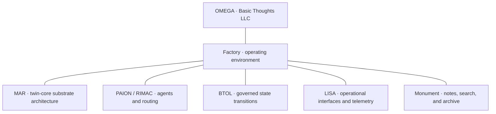

# OMEGA architecture

[Overview](README.md) · [Systems and artifacts](PROJECTS.md) · [Results](RESULTS.md)

OMEGA is the umbrella computing ecosystem developed by Basic Thoughts LLC. It connects several product and architecture lines through a shared operating environment. The boundaries between those lines are part of the design.

## System map

This is a product relationship map. It groups architecture lines and their intended roles; it is not a deployment or network wiring diagram.

## MAR: substrate and twin-core design

MAR's design lineage begins with coupled collider/reactor geometry, a controlled core, and an ordered transition into a held substrate state. Its scale-down target is a twin-core processor architecture with complementary compute domains and local memory/accelerator placement.

The sequence is architectural: the design establishes and stabilizes state, advances through gated stages, and holds the resulting state before compute. Preserving those dependencies is central to the implementation question.

The technical paper connects that design to a bounded staged-control comparison. The detailed run reports final order of **0.998505** for the staged protocol and **0.998193** for the flattened protocol. Their path-fidelity scores differ: **1.000** and **0.375**. That comparison makes sequence preservation visible even when endpoints look similar. [Inspect the result](RESULTS.md#mar-sequence).

Related expert-routing work studies execution order, topology caching, and memory placement while preserving the model computation. The [routing proxy](RESULTS.md#expert-routing) and [NUMA scenarios](RESULTS.md#memory-placement) retain separate result labels.

The physical architecture, classical control comparison, routing proxy, and device benchmark are distinct artifacts. Their connection is explained here without treating one as the implementation of another.

## PAION / RIMAC and acquisition workflows

PAION / RIMAC covers agent and routing architecture. Acquisition, intake and retrieval functions are mapped to their actual implementation source records and Factory interfaces, without introducing an unapproved named product. The August 5 architecture paper documents related architecture lineage.

## BTOL and LISA

BTOL describes instructions as governed state transitions carrying identity, capability, intent, routing, and an observable result. Its specification defines access tiers, policy evaluation, execution modes, and ledger recording.

LISA, Living Integrated Swarm Awareness, presents system state through telemetry and operator interfaces. The repository contains dashboard code, heartbeat and handshake services, unified-engine code, and topological simulation code. The architecture documents connect these surfaces through operational state and continuity.

## Monument and the Factory

Monument is a distinct notes, search, and archive product with consumer and operator surfaces. The Factory is the broader operating environment where the products and infrastructure can interoperate. Monument supports the ecosystem's knowledge workflows; it does not define MAR's substrate lineage.

## Architecture record

This overview draws on the **OMEGA MAR Twin-Core Architecture Technical Paper** dated August 5, 2026; **LISA — System Architecture, Purpose, and Technical Foundation**; and **BTOL Governance & Access Specification**. The [source register](data/provenance.json) identifies the documents and hashes used for this edition. Implementation and deployment maturity are described by component in the [systems register](PROJECTS.md).
