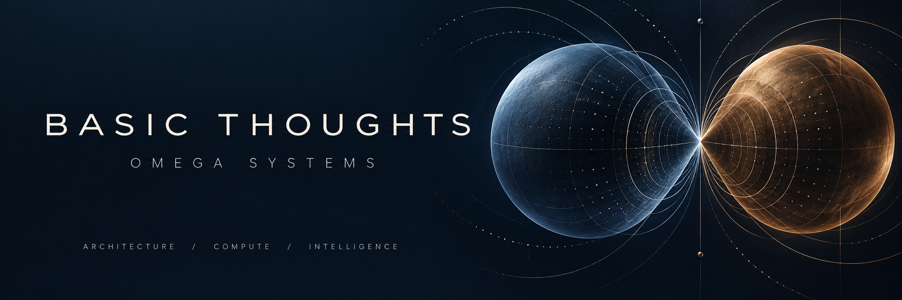
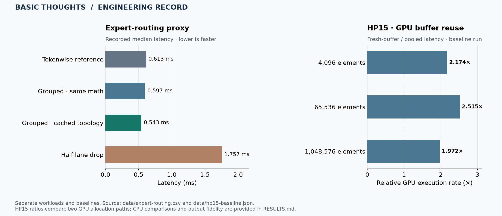

# Benjamin Thomas Murphy · Basic Thoughts LLC

**Systems architecture · Python services · AI orchestration · Compute experiments · Evidence-driven engineering**

I’m developing **OMEGA**, a computing ecosystem connecting governed AI orchestration,
knowledge workflows, operator interfaces, and MAR twin-core substrate research.
This portfolio shows the products, the engineering artifacts behind them, and
the results you can inspect—not just a list of technologies.

Created by **Benjamin Thomas Murphy**, the work spans system design, software implementation, device experiments, and computational modeling. Its organizing principle is continuity: preserve the architecture, the sequence of execution, and the evidence of what happened.

**[Product catalog](PRODUCTS.md)** · **[Results & datasets](RESULTS.md)** · **[For employers](FOR-EMPLOYERS.md)** · **[Architecture](ARCHITECTURE.md)**

## Start here: three ways to evaluate the work

| What you want to assess | Start with | What you can inspect |
| :--- | :--- | :--- |
| Systems design and product thinking | [Product catalog](PRODUCTS.md) | Product purpose, distinct boundaries, available artifacts and maturity. |
| Performance analysis | [Results and raw data](RESULTS.md) | Named workloads, baselines, all comparison scenarios, and calculation checks. |
| Software implementation and operations | [Employer guide](FOR-EMPLOYERS.md) | API/storage work, orchestration, audit integration, and clear evaluation limits. |

## One ecosystem. Distinct systems.

| System | Role |
| :--- | :--- |
| **MAR** | Twin-core programmable-substrate architecture, staged transitions, and compute-placement experiments. |
| **PAION / RIMAC** | Agent and routing architecture that interfaces with the wider OMEGA environment. |
| **Omega X** | Acquisition, intake, and retrieval-augmented knowledge workflows. |
| **BTOL & LISA** | Governed state transitions, operational telemetry, and human-readable system interfaces. |
| **Monument** | Interactive notes, search, and archive workflows for users and operators. |
| **Factory** | The operating environment in which these systems interoperate. |

## Engineering results, with the data attached

- **1.128× reference speed** with **1.0 cosine similarity** in the recorded expert-routing proxy using cached topology. [Four-scenario dataset →](RESULTS.md#expert-routing)
- **1.97×–2.52× measured GPU buffer-reuse gains** against fresh allocation across three HP15 workload sizes. [Raw timing samples & benchmark →](RESULTS.md#device-compute)
- **1.000 versus 0.375 path fidelity** in the reported staged-versus-flattened MAR control comparison, despite nearly identical final order. [Comparison & method →](RESULTS.md#mar-sequence)

Read the [results register](RESULTS.md) for workloads, baselines, measured values, and modeled scenarios. Each result has a defined scope.

The chart presents selected recorded workloads, not a ceiling on OMEGA's capabilities or a whole-system assessment. Each linked dataset describes its own method and evaluation context. The [catalog](PRODUCTS.md) identifies distinct product families and points to their available records; a public excerpt does not determine the maturity of the complete private system.

## Explore the work

**For technical collaborators:** follow the [architecture map](ARCHITECTURE.md), inspect the [datasets](data), and [verify the recorded calculations](reproduce/README.md).

**For employers and technical collaborators:** use the [evaluation guide](FOR-EMPLOYERS.md)
to choose an artifact-led discussion about systems integration, Python services,
knowledge workflows, performance measurement, or research engineering.

### Four-qubit oscillator simulation

[Explore the recursive manifold experiment](simulations/oscillator-fractal/README.md): four logical qubits per modeled graphene–microtubule oscillator, independent horizontal and vertical addressing, and 16 ordered phase/braid stages. In the published Red-host CPU/NumPy batching comparison, the 1,024-oscillator case records **25.39×** relative to individual NumPy dispatch. This is one experiment with a defined baseline, **not an OMEGA-wide performance maximum or judgment about results from other architectures, devices, or runs**.
