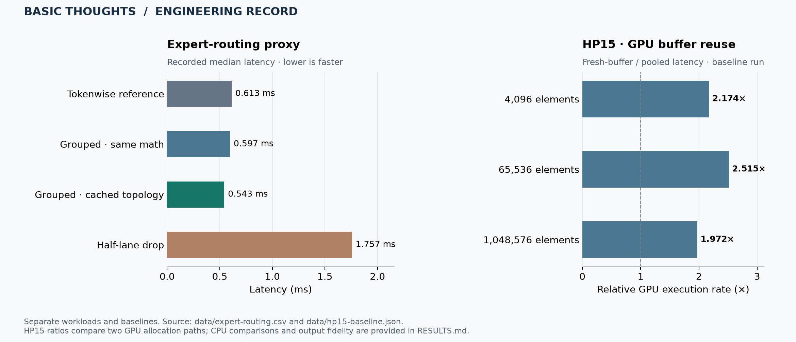

# Engineering results and datasets

[Overview](README.md) · [Architecture](ARCHITECTURE.md) · [Verify calculations](reproduce/README.md) · [Source register](data/provenance.json)

The results below come from different workloads. Each table identifies its baseline, evidence type, and comparison. Recorded data are preserved alongside calculation checks.

[Download the figure as PDF](assets/engineering-results.pdf).

## Expert routing: preserve the computation, improve execution

**Evidence:** recorded executed proxy, July 13 engineering report. **Baseline:** tokenwise reference implementation.

| Scenario | Median latency (ms) | Reference / scenario | Cosine vs. reference |
| :--- | ---: | ---: | ---: |
| Reference tokenwise | 0.612825 | 1.000000× | 1.000000 |
| Expert grouped, same math | 0.597182 | 1.026195× | 1.000000 |
| Expert grouped, cached topology | 0.543172 | **1.128234×** | **1.000000** |
| Arbitrary half-lane drop | 1.757496 | 0.348692× | 0.715923 |

The cached-topology row records approximately **12.82% higher execution rate**, equivalent to **11.37% lower latency**, than the reference in this proxy. All four scenarios remain visible. This is a bounded routing result; a full-model throughput measurement is a separate experiment.

[Download exact recovered CSV](data/expert-routing.csv). The CSV contains scenario medians and similarity values; per-repetition samples are not included in that recovered file.

## HP15 device compute: measure the cost of buffer allocation

**Evidence:** recorded hardware benchmark on Intel UHD Graphics 620, September 13 branch package. **Workload:** identical float32 input transformed by `y = 1.25*x + 0.5`. One warmup and 15 timed repetitions per case.

| Elements | CPU median (ms) | Pooled GPU median (ms) | Fresh-buffer GPU median (ms) | Fresh / pooled GPU |
| ---: | ---: | ---: | ---: | ---: |
| 4,096 | 0.004088 | 0.126973 | 0.275981 | **2.174×** |
| 65,536 | 0.029104 | 0.148553 | 0.373542 | **2.515×** |
| 1,048,576 | 1.150773 | 1.613513 | 3.182469 | **1.972×** |

Buffer reuse improves the recorded GPU path at all three sizes. The CPU column supplies the separate CPU comparison: CPU latency is lower for these inputs. The result is a device-level allocation experiment, distinct from the MAR substrate implementation.

Maximum absolute output error in the baseline is **1.1920928955078125e-7**. The raw files include all timing samples, device information, kernel timings, and resident-dispatch timings.

[Baseline raw samples](data/hp15-baseline.json) · [Performance-mode trial raw samples](data/hp15-performance.json) · [Exact baseline benchmark source](reproduce/hp15-benchmark-tested.py)

The performance-mode trial is retained as a separate run; it is not substituted into the baseline table. Current checks recompute statistics from these records. They do not rerun the remote GPU experiment.

## MAR: sequence fidelity distinguishes similar endpoints

**Evidence:** detailed run reported in the August 5 architecture paper. **Method:** classical grouped-phase control comparison, 48 oscillators in eight bundles, staged protocol versus flattened control ramp.

| Metric | Canonical staged | Flattened |
| :--- | ---: | ---: |
| Transition time, normalized model units | **85.20** | **16.65** |
| Final order | 0.998505 | 0.998193 |
| Path fidelity | **1.000** | **0.375** |
| Hold stability | 0.996376 | 0.994909 |
| Twin-pool lock | 0.880810 | 0.904610 |

Both runs reach a highly ordered endpoint, while the defined sequence-gate score separates their histories. This is the reported result behind MAR's emphasis on preserving staged causal structure.

The paper also describes 40 randomized runs per protocol. This table is the detailed run, not an aggregate of those runs. [Machine-readable transcription](data/mar-reported-comparison.csv) identifies values transcribed from the paper; the original trace and randomized-run files were not recovered in this review. The comparison concerns a classical control model, with physical substrate validation tracked separately.

## NUMA placement: a modeled engineering scenario

**Evidence:** digital-twin scenario calculations from the July 13 report and recovered CSV. The model assumes local bandwidth of 55 GiB/s, remote bandwidth of 28 GiB/s, and a 32 GiB/s inter-socket activation path.

| Scenario | Modeled segment (ms) |
| :--- | ---: |
| Centralized, unpinned memory service | 106.627398 |
| Centralized plus per-token MAR controller | 237.480863 |
| Dual local workers plus persistent MAR controller | 38.186238 |

[Exact recovered scenario CSV](data/numa-scenarios.csv). These are placement and controller-cost scenarios. They are not measurements of full 236B model inference.

## Verification and provenance

Run `python3 reproduce/verify_results.py` from this repository to validate the published file hashes, recompute HP15 timing statistics, and check the routing ratios. [Instructions](reproduce/README.md) explain the distinction between checking recorded data and rerunning a workload.

Application and recovery-library checks are listed separately in [VERIFICATION.md](VERIFICATION.md). Every public result links to its data or identifies its reported source.
