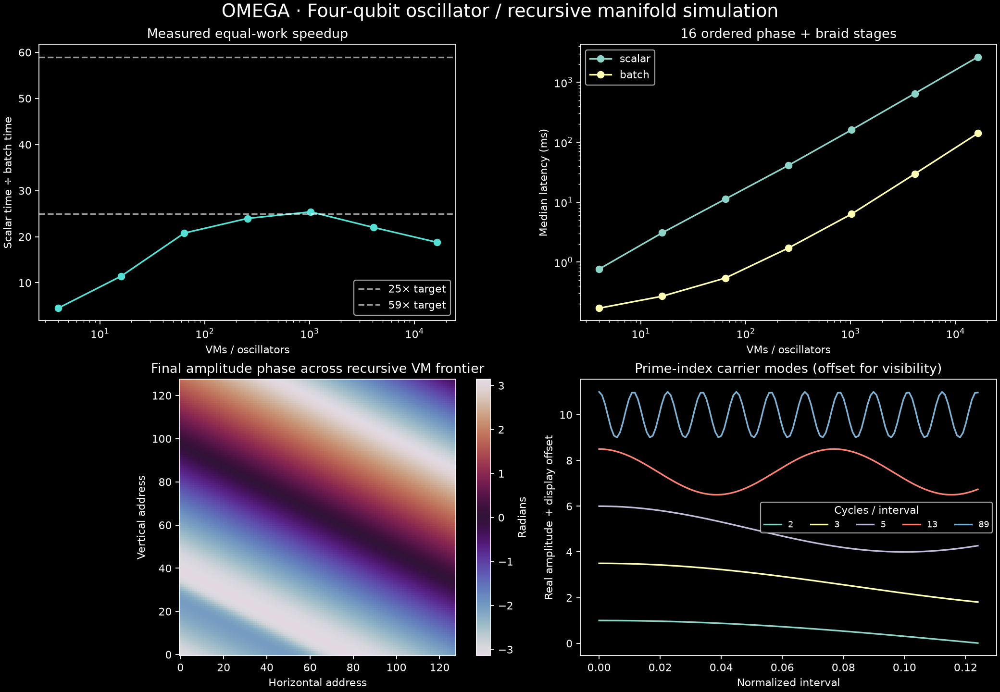

# OMEGA · Four-qubit oscillator simulation

Every materialized fractal VM contains one modeled graphene–microtubule oscillator, assigned four logical qubits (16 complex128 amplitudes). Horizontal and vertical recursion addresses are retained separately. The materialized frontier grows from 4 to 16,384 VMs.



## Reproduce

```bash
python3 -m venv .venv
.venv/bin/pip install numpy matplotlib
OPENBLAS_NUM_THREADS=1 OMP_NUM_THREADS=1 .venv/bin/python run.py
```

Five alternating-order trials per case follow correctness checks and warmup. Compare median scalar dispatch against median batched dispatch, with identical initial states, phase schedules, braid word, precision and output shape. Setup is excluded from both. **Benchmark scope:** Python/NumPy scalar dispatch compared with batched dispatch on host Red. This publication does not compare other accelerator paths or claim to be an exhaustive survey of Omega deployments.

## Four-qubit interpretation

Each oscillator stores a full 16-amplitude local state. Across oscillators the state is factorized; cross-oscillator entanglement is not simulated. At 16,384 oscillators there are 65,536 logical qubit labels, but this is NOT a dense 65,536-qubit quantum simulation. State arrays use 4 MiB, excluding phase arrays, temporary arrays and process overhead. A general entangled register would require 2^(4N) amplitudes.

The benchmark models a graphene–microtubule oscillator with a phase-gate controller and four logical qubit labels per oscillator. Its numerical implementation and preserved reference source are documented in `run.py` and `manifold_reference.py`. The modeling assumptions are specific to this experiment.

## Scope map

OMEGA is the orchestration architecture; LISA, BTOL (Basic Thoughts Omega Language, `.btol`), MAR twin-core, Murphy Manifold, Saturn, PAION/RIMAC, OMEGA Telemetry, Monument, Factory, Sentinel and audit have their own functions within the wider ecosystem. This repository directory publishes a **finite recursive oscillator kernel** and a normalized spectral-carrier test; it is one technical experiment, not a complete inventory of those systems.

The display → spectral → manifold → VM → oscillator → readout pipeline provides the architectural context. Containment, soliton storage, hardware output translation, and compression belong to their respective source and implementation records and are **not evaluated by this NumPy benchmark**.

## Evidence

`results.json` contains all timings, errors, environment and assumptions. `run.py` contains the executed model; `manifold_reference.py` preserves the recovered reference byte-for-byte (source SHA-256 1c3a3504bbbf997445a05f5f3634a931eadc5815d43905a7498e2712c6a7c1f9). `sha256.json` records artifact hashes. Spectral frequencies 2, 3, 5, 13, 89 are cycles per normalized interval, with 1,024 samples; orthogonality follows the sampled Fourier grid, not primality alone.

**Recorded comparison:** **25.39×** at **1,024 oscillators** in the Red-host scalar-versus-batched NumPy workload. All seven timing cases remain available in `results.json`. These results describe **only this particular benchmark configuration and baseline**, not the performance limits of OMEGA, MAR, PAION, other compute substrates, or subsequent runs.
